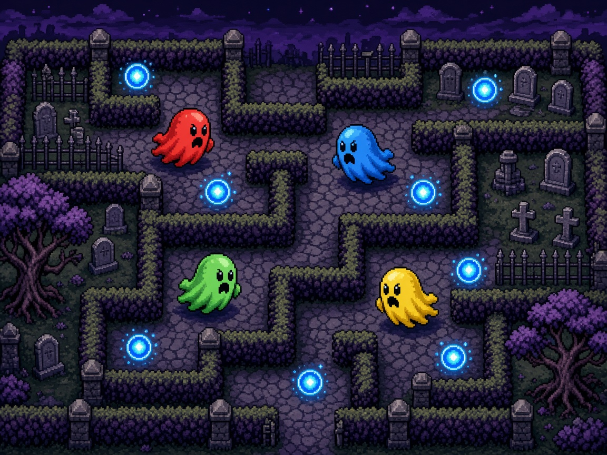

# Graveyard Grab

Four ghosts, one graveyard, two minutes. Soul orbs blink into a maze of tombstones. Grab them, haul them home to your crypt, and tag anyone who gets in the way — a tag steals an orb, and an empty-handed ghost gets banished back to the gate. Every fifteen seconds the stones slide into a new maze. Most banked souls when the clock dies wins the round.

Play it on one keyboard with friends, with gamepads, or solo against bots. Nothing to install beyond Python 3. The page is plain HTML5 canvas and runs offline.

## Launch

| Platform | How |
| --- | --- |
| macOS | Double-click `launch-mac.command` |
| Windows | Double-click `launch-windows.bat` |
| Linux | `chmod +x launch-linux.sh` once, then `./launch-linux.sh` |
| Already in a terminal | `python3 server.py` |

The launcher looks for Python 3 and tells you how to get it if the command is missing. It serves the game on `127.0.0.1` at port **8808** (from `arcade.json`). If that port is taken, it steps to the next free port and opens your browser.

From the title screen press **Enter** or **Start**. Empty seats start as bots; a seat's action key claims it, and secondary toggles that seat between Bot and Off. You need at least one ghost in the yard.

## Controls

Keyboard works with no gamepads plugged in. A connected gamepad replaces that seat's keys (pad 0 is P1 … pad 3 is P4) and drops back to the keyboard the moment it unplugs. Left stick or D-pad moves, **A** is action, **B** is secondary, **Start** pauses.

| Seat | Move | Action (dash) | Secondary (relic / drop) |
| --- | --- | --- | --- |
| P1 Moss | W A S D | F | G |
| P2 Brick | Arrow keys | `/` | `.` |
| P3 Banjo | I J K L | `;` | `'` |
| P4 Cobalt | Numpad 8 4 5 6 | Numpad 0 | Numpad Enter |

**M** mutes. **Esc** pauses. Settings (from the title or the pause menu) change volume, round count (1, 3, or 5), and every binding. Remaps are stored in `localStorage` under `graveyardgrab.binds` and `graveyardgrab.settings`.

Connected pads show a small pad glyph on that ghost's HUD card.

## Rules

- The maze is a tile yard. Tombstone walls are always fully connected, and they **shift every 15 seconds** from a seeded generator. Ghosts and orbs that would be buried are pushed onto the nearest open tile.
- Soul orbs spawn in the corridors. Touch one to carry it. You can hold five.
- **Tag** another ghost (walk into them while facing them) to steal one carried orb. They are briefly invulnerable, so you cannot chain tags.
- Tag a ghost who is holding nothing and they are **banished** — eliminated for a few seconds, snapped back to their crypt, then sent out with a fresh shield of invulnerability.
- Step onto **your** crypt to bank every orb you are carrying. Rival crypts do nothing for you.
- **Action** is a short dash. **Secondary** uses a held relic, or drops one orb if your hands are empty of relics.
- Relics appear on the path: **haste** (faster), **phase** (walk through tombstones), **shield** (block the next tag), **magnet** (pull nearby orbs).
- A round lasts **2:00**. The ghost with the most banked orbs wins the round. Ties share the round win.
- A match is the chosen number of rounds. Standings break ties by total orbs banked, then fewer banishments, then the lower seat. Rematch, or go back to the title.

Bots fill any seat that nobody claimed, so a single player can still race.

## Scoring

The HUD shows the round clock, how soon the stones will shift, and for each ghost: orbs banked this round, round wins, and the orbs in hand. A round-win banner names the leaders. The match screen lists the standings.

## arcade.json

`arcade.json` is the arcade-OS manifest: display name, id `graveyardgrab`, icon, cover, per-platform launch command, 4 players (minimum 1), keyboard and gamepad input, version `1.0.0`, and port `8808`. `server.py` reads that port so the launcher and the manifest stay in step.

## Tests

Core rules live in `src/core/` with no DOM and no canvas, so they run headlessly. Rendering, input devices, and synthesized audio live in `src/ui/`.

```bash
node --test tests/
python3 tests/smoke_server.py
```

Node's built-in test runner covers movement and collision, banking, round and match wins, banishment, relics, seeded RNG determinism, keyboard and mocked gamepad mapping, and that `arcade.json` points at files that exist. The Python smoke test checks port fallback and that `server.py` actually serves `index.html`. GitHub Actions runs both on push and pull request.

Randomness goes through a seeded generator, so the same seed and the same inputs replay the same match.

## License

[MIT](LICENSE).
